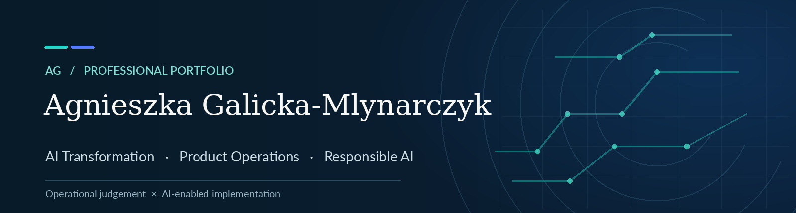

### Senior operations leadership meets practical AI implementation.

I work at the intersection of **business operations, product thinking and AI-enabled transformation**. My background is in leading complex operations, improving processes and creating systems that teams can actually use. I'm extending that experience through hands-on, AI-assisted product development and responsible implementation.

> **My principle:** Start with the real business problem. Automate what is appropriate. Keep people accountable for decisions that matter.

---

### Selected work

| Project | Business problem & contribution | Stage |
| :--- | :--- | :--- |
| **AI-assisted compliance platform** | Initiated and helped prototype a more structured RAMS/COSHH workflow; defined requirements, tested document generation and explored safety safeguards. | **Prototype / testing** |
| **Operational transformation** | Introduced more consistent processes, documentation and accountability across compliance, service delivery and financial administration. | **Professional experience** |
| **Creative AI Lab** | Original food filmmaking, generative storytelling and experimental AI-assisted production workflows. | **Selected experiments** |

**Featured case study in development:** An internal compliance workflow that previously required around half a working day for preparation, plus review. Prototype outputs include on-screen assessments and downloadable documents. **No real-client rollout or measured savings are claimed.**

### Responsible AI in practice

In testing, the compliance prototype generated **irrelevant hazards** and **unsupported statements about employee training**. We revised its instructions, retested and saw improvement, but some assumptions remained. That experience shaped my approach to:

- **Factual grounding:** verified source information rather than plausible assertions.
- **Human oversight:** competent review and explicit approval for safety-critical outputs.
- **Security and privacy:** protected credentials, appropriate access and synthetic demonstration data.
- **Honest evaluation:** document failures, test changes and distinguish prototypes from production systems.

*Useful AI must also be dependable. Prompt instructions alone do not establish reliability.*

### How I work

**Discover** — understand users, constraints, risks and existing processes.  
**Design & prototype** — define requirements, prioritise value and use appropriate tools.  
**Test & improve** — challenge outputs, evaluate limitations and plan for adoption.

**Tools I'm learning through projects:** React / TypeScript · Supabase · GitHub · Vercel · APIs · AI-assisted coding · workflow automation

My established expertise is **operations and transformation**. I use AI-assisted coding and technical guidance to develop practical implementation fluency while remaining accountable for business requirements, decisions and evaluation.

---

**Interested in AI Operations, Product Operations, AI Implementation and Transformation.**  
[**Contact me**](mailto:agnieszka.galicka.ai@gmail.com) · [**View my GitHub**](https://github.com/galicza-svg)

*Public project demonstrations and the updated portfolio website will be linked here after review for accuracy, confidentiality and publication permissions.*
